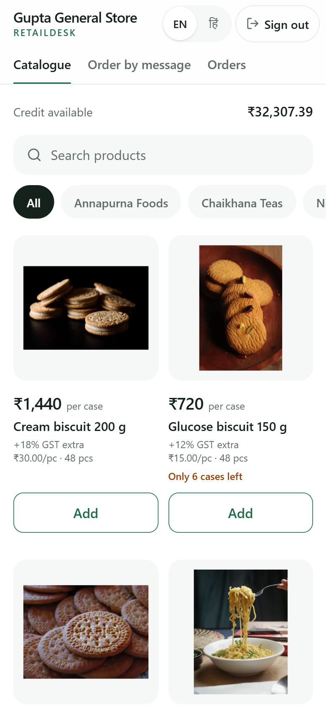
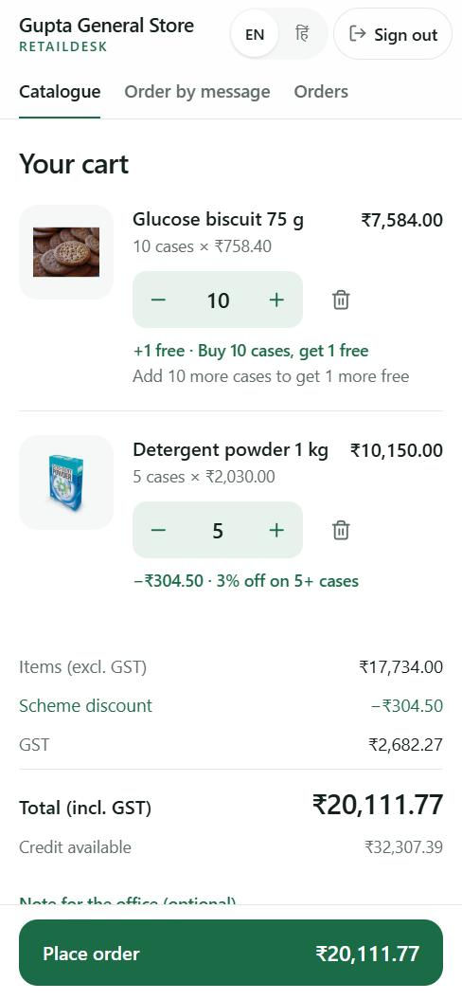
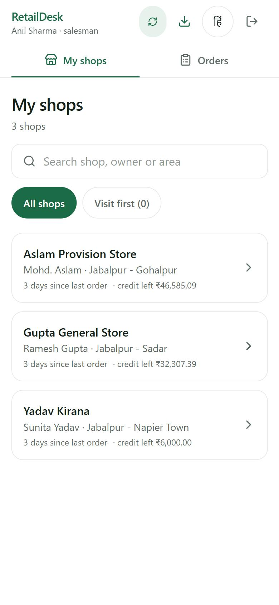
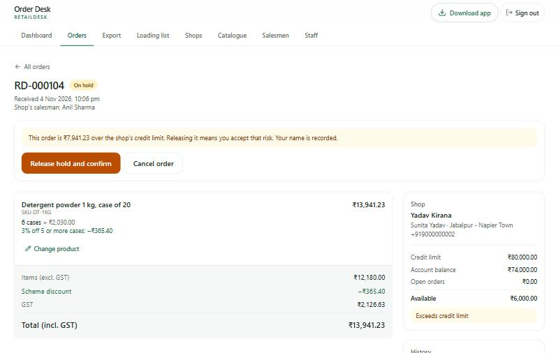
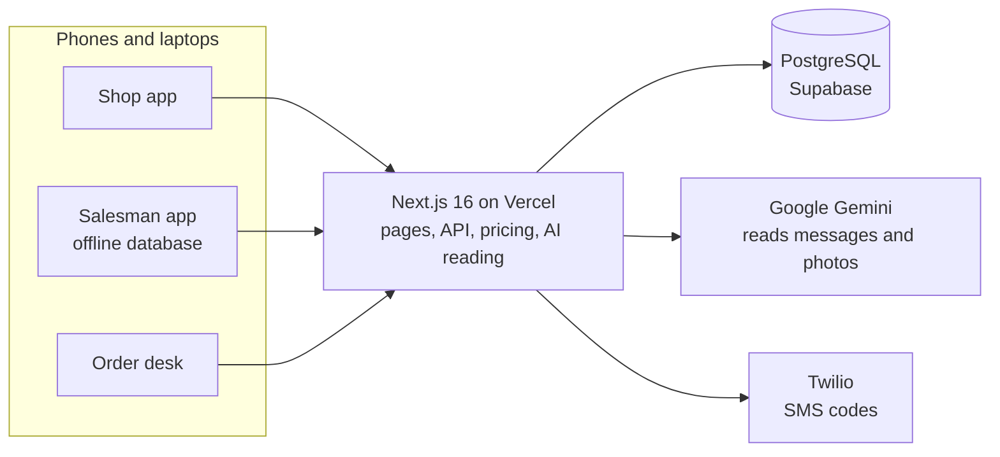

# RetailDesk

**Order management for a distributor and the kirana shops it supplies.**

Shopkeepers see stock, their own price and the current scheme, and order in about a minute. Salesmen take orders in the shop, even with no signal. Messages and photos of handwritten lists become orders that the office only has to check, not retype.


**[Live app](https://retaildesk-pied.vercel.app)** · **[Deployment and demo logins](deployment.md)** · **[Scope and assumptions](docs/scope.md)**

<p align="center">
  
  &nbsp;
  
  &nbsp;
  
</p>
<p align="center">
  
</p>

---

## Contents

- [Why it exists](#why-it-exists)
- [Features](#features)
- [How it works](#how-it-works)
- [Tech stack](#tech-stack)
- [Getting started](#getting-started)
- [Demo access](#demo-access)
- [Scripts](#scripts)
- [Project structure](#project-structure)
- [Testing](#testing)
- [Security](#security)
- [Status and limits](#status-and-limits)
- [Documentation](#documentation)

---

## Why it exists

The distributor supplies about 1,800 shops in Jabalpur through 18 salesmen. Orders arrive as notebook entries, WhatsApp texts, photos of handwritten lists and Hindi voice notes, and an office team retypes them into Tally the next morning. Salesmen cannot see stock or schemes at the counter, so lines are cut later.

RetailDesk puts the facts in front of the person ordering (stock, price, scheme, credit) and takes the order straight into the system. The office checks orders instead of typing them.

## Features

### Shopkeepers
- **Sign in by SMS code**, in English or Hindi.
- **A catalogue made for a phone:** large product pictures, the price first, GST always stated, schemes shown on the product, stock shown only when it is low or out.
- **Schemes that explain themselves:** "Buy 10 cases, get 1 free", "3% off on 5+ cases", and a nudge such as *Add 4 more cases for 3% off*.
- **A quick cart** with live totals, credit available, and one-tap **repeat order**. An order over the credit limit is held for the office, not rejected.
- **Order by message or photo:** paste a WhatsApp list or photograph a handwritten one. The app reads it into lines, and the shopkeeper checks each line before anything is ordered.
- **Installable** from the browser, with an offline page.

### Salesmen
- **My shops:** only the shops assigned to them, with the quiet ones first.
- **Order on a shop's behalf** with that shop's own prices, schemes and credit.
- **Works offline.** Orders are saved on the phone and sent when the signal returns. The server prices every order again and shows the salesman exactly what changed.
- **Safe on a shared phone:** signing out removes shop data from the device.

### The order desk
- **Order queue** with credit holds, order detail and history. Confirm, release a hold, or cancel with a reason.
- **Exports:** an Excel sales register (with a GST summary), a Tally Prime XML file, and a printable van loading list.
- **Dashboards:** sales, and shops with no order in 14 days with call and WhatsApp buttons.
- **Catalogue admin:** products, prices, GST, stock changes with a reason, schemes with dates, and per-shop prices, each with a history of who changed what.
- **People:** add and switch off shops, salesmen and desk staff. Switching someone off signs them out at once.

### AI order capture
- Reads **typed or pasted messages** (English, Hindi, Hinglish) and **photos of a list**.
- Every line shows the **original words**, a **confidence label** and **two alternatives**. An unclear quantity or unit (case or piece) is **asked, never guessed**.
- **Nothing is ordered until the shopkeeper confirms.** Corrections become that shop's own shorthand for next time.
- If the AI is slow or down, typed messages fall back to a simple built-in reader, and photos ask the shopkeeper to type the list.

## How it works



A few decisions that shape the code:

- **The server is the authority on money.** The browser shows a live total with the same pricing engine, but when an order is placed the server prices it again from the database. A phone only sends product ids and case counts.
- **The scheme engine is a pure function:** numbers in, numbers out, no database. The same code runs in the browser, on an offline phone and on the server. It is checked against an independent exact calculator on 20,000 random lines.
- **Money is whole paise.** Prices are per piece, orders are whole cases, GST is in basis points, and rounding happens once per line.
- **The AI reads, the code decides.** Gemini turns a message or photo into lines of words and numbers. The app's own matcher chooses the product and scores its confidence. The AI never sees prices, credit or other shops.
- **Offline is the normal path for salesmen,** not a special mode: the app always works from a copy on the phone and syncs when it can.
- **Light on slow phones:** no web fonts, no chart library, product photos of about 10 KB, and about 210 KB compressed on a first load.

## Tech stack

| Part | Choice |
| --- | --- |
| App | Next.js 16 (App Router), React 19, TypeScript |
| Styling | Tailwind CSS 4 |
| Database | PostgreSQL on Supabase, through Prisma 7 with tracked migrations |
| Sign-in | Own implementation: `jose` session cookies, `argon2` passwords, hashed one-time codes |
| SMS | Twilio, behind a small interface |
| AI | Google Gemini (text and image reading) |
| Files | ExcelJS (sales register), `sharp` (product photos) |
| Validation | Zod |
| Tests | Vitest |
| Hosting | Vercel (Mumbai region), Supabase |

## Getting started

You need **Node.js 20 or newer** and a Postgres database (a free Supabase project works).

```bash
git clone https://github.com/Tarun9076/RetailDesk.git
cd RetailDesk
npm install
cp .env.example .env        # then fill it in
npm run db:deploy           # create the tables
npm run db:seed             # demo data
npm run dev                 # http://localhost:3000
```

The full guide (environment variables, deployment to Vercel and Supabase, backups, troubleshooting) is in **[deployment.md](deployment.md)**.

## Demo access

Demo data is invented. Shop owners and salesmen sign in with a demo number and the fixed code `246810`.

| Role | Sign-in page | Login |
| --- | --- | --- |
| Shop owner | `/login` | `9000000001` (Gupta General Store) |
| Salesman | `/sales/login` | `9100000001` (Anil Sharma) |
| Order desk | `/desk/login` | `desk@retaildesk.demo` (password is set by `SEED_DESK_PASSWORD`) |

All demo numbers and what each one is good for trying are listed in [deployment.md](deployment.md#4-demo-login-details-for-the-reviewer).

## Scripts

| Command | What it does |
| --- | --- |
| `npm run dev` | Start the app in development |
| `npm run build` / `npm start` | Production build and server |
| `npm test` | Run the unit tests |
| `npm run lint` | Lint the code |
| `npm run db:deploy` | Apply the migrations |
| `npm run db:seed` | Wipe and recreate the demo data |
| `npm run db:backup` / `db:restore` | Save every table to a file, or load a backup into an empty database |
| `npm run desk:reset` | Set a desk password from the command line |
| `npm run photos` | Resize photos in `product-photos/` and link them to products |

## Project structure

```text
prisma/                 Schema, migrations and demo seed data
scripts/                Backup, restore, desk password reset, product photos
public/                 Service worker, offline page, product photos
src/
  app/
    (retailer)/         Shop screens: catalogue, cart, orders, order by message
    sales/              Salesman app
    desk/               Order desk
    api/                Auth, orders, capture, sync, desk and health endpoints
  components/           Shared UI, plus retailer/, field/ (salesman) and desk/
  lib/
    pricing/            The scheme engine
    orders/             Building, placing and exporting orders
    capture/            AI reading, matching and learning
    auth/               Sign-in codes, sessions, rate limits, SMS
    field/              Salesman sync and offline queue
    catalogue-admin/    Product, stock and scheme rules
    tally/              Excel register and Tally XML
    i18n/               English and Hindi text
docs/                   Scope and assumptions, screenshots
```

## Testing

```bash
npm test
```

301 unit tests cover the logic where a mistake would cost money or trust: the scheme engine (with property tests against an independent calculator), order building and credit, sign-in and session rules, AI reading and matching for text and photos, Tally and Excel output, dashboard maths, the offline queue and catalogue rules.

Beyond unit tests, scripts were run against a production build and a real database for concurrency (two buyers for the last stock), permissions, stock changes, sign-in, photo capture, and a backup restored and compared row by row. Test data was removed afterwards.

## Security

- Access control is enforced on the server for every request. A shop only receives its own prices and credit, and a salesman only receives his own shops.
- Every request body is validated with Zod, and browser writes must come from the app's own origin.
- Sign-in codes and passwords are hashed. Codes expire, work once and lock after five wrong tries. Requests are rate limited, and a user is looked up on every request, so switching someone off takes effect at once.
- Uploaded photos are checked by their real file type and size, and are not stored.
- No secrets are in the repository. Settings come from environment variables.

## Status and limits

Everything above is built and deployed. What is not done or not proven:

- The Tally XML has not been imported into a real Tally, and ledger names are defaults.
- Reading balances back from Tally was built and then removed. A shop's balance is set by the desk and raised by exported orders.
- Photo reading was tested with generated images, not real handwriting on paper.
- Hindi voice notes are not built.
- There are no browser tests or CI yet, and the Hindi text has not been reviewed by a native speaker.

The full list, with effort estimates, is in [deployment.md](deployment.md#7-known-limits) and [docs/scope.md](docs/scope.md).

## Documentation

| Document | What it covers |
| --- | --- |
| [deployment.md](deployment.md) | Running locally, deployment, environment variables, operations, demo logins |
| [docs/scope.md](docs/scope.md) | What is in and out of scope, and every assumption made where the brief was silent |

---

Built by [Tarun](https://github.com/Tarun9076).
